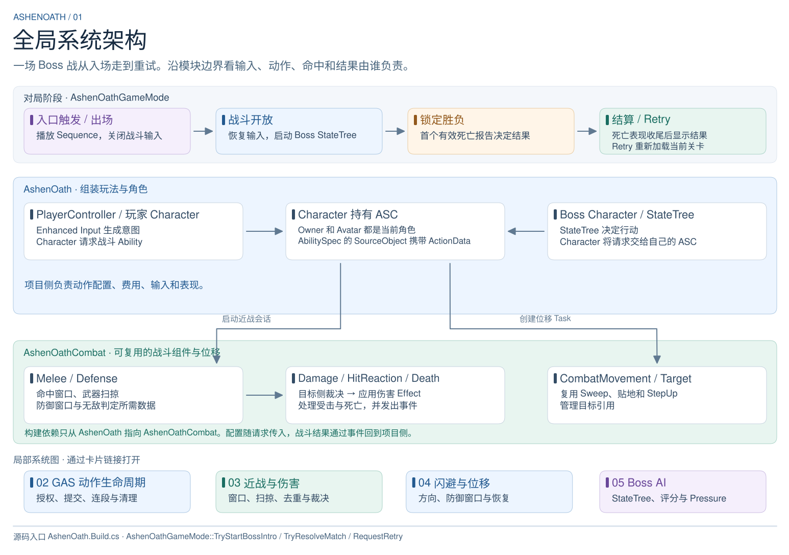

# AshenOath

AshenOath 是使用 Unreal Engine 5.8 开发的单人第三人称 Boss 战项目。玩家在竞技场中运用连招、蓄力重击、闪避和治疗与 Boss 战斗。项目重点包括 GAS 战斗动作、可复用战斗组件，以及 StateTree 和 Utility Scoring 驱动的 Boss AI。

## 架构总览

## 主要功能

**1. 玩家战斗与控制**

基于 Enhanced Input 处理移动、镜头、攻击、闪避、治疗和锁定。玩家可以锁定当前 Boss，镜头随目标平滑追踪；锁定后轻击可在满足条件时辅助调整朝向和接近目标。

轻击支持点按与长按连招；重击持续消耗耐力，伤害随实际消耗量变化，并可在蓄力阶段通过闪避取消。闪避通过位移 Sweep 处理地形与阻挡，治疗在动画指定时刻成功生效后消耗次数。

**2. GAS 与近战伤害**

玩家和 Boss 各自持有 Ability System Component 和 AttributeSet，通过 GameplayAbility、GameplayEffect 和 GameplayTag 管理动作、费用、生命、耐力和角色状态。耐力消耗后延迟恢复。

近战攻击通过 Montage Notify 开启命中窗口，连续扫掠武器并在窗口内对目标去重。目标侧处理伤害、无敌判定、受击硬直和死亡；Montage 播放实例用于区分当前动作与过期动画回调。

**3. Boss AI**

Boss 拥有单次挥击、连续挥击、蓄力重挥和突进挥击四种招式。StateTree 编排决策、接近、观察、攻击和恢复，Utility Scoring 根据距离、朝向、冷却和近期出招选择动作。

Pressure 随已受理的攻击累积，达到上限后 Boss 进入喘息；观察阶段释放 Pressure，降至恢复阈值后继续进攻。

**4. 对局流程与表现**

进入竞技场后可播放 Boss 出场 Sequence，演出结束后开放玩家操作并启动 Boss AI。首个有效死亡报告确定胜负，等待死亡表现和收尾后显示结算界面，玩家可重新加载当前关卡重试。

HUD 展示玩家生命、耐力、治疗次数、重击蓄力状态和 Boss 生命。战斗包含命中、受击、死亡的声音与粒子反馈，以及死亡后的物理和表现收尾；具体素材由项目资产配置。

**5. 模块设计**

`AshenOath` 负责组装角色、输入、GAS Ability、Boss AI、镜头、对局和 UI。`AshenOathCombat` 提供近战检测、防御窗口、伤害、受击、死亡、目标持有和位移 Task，依赖方向为 `AshenOath → AshenOathCombat`。

具体 GameplayAbility 管理单次动作生命周期，AbilityTask 处理异步工作，ActionData 保存配置；通用战斗组件不依赖具体玩家、Boss 或 UI 类型。

### 项目文档

- [架构总览](docs/arch/architecture.md)
- [GAS 与属性](docs/systems/ability-system.md) · [战斗动作与伤害](docs/systems/combat-actions.md)
- [Boss AI](docs/systems/boss-ai.md) · [对局流程](docs/systems/match-flow.md)
- [架构决策：Character 持有 Ability System](docs/adr/0001-character-owned-ability-system.md)
- [架构决策：Controller 与 Character 的输入边界](docs/adr/0002-player-input-and-character-boundary.md)
- [架构决策：GameplayAbility 拥有动作生命周期](docs/adr/0003-gameplay-ability-owns-combat-action-lifecycle.md)
